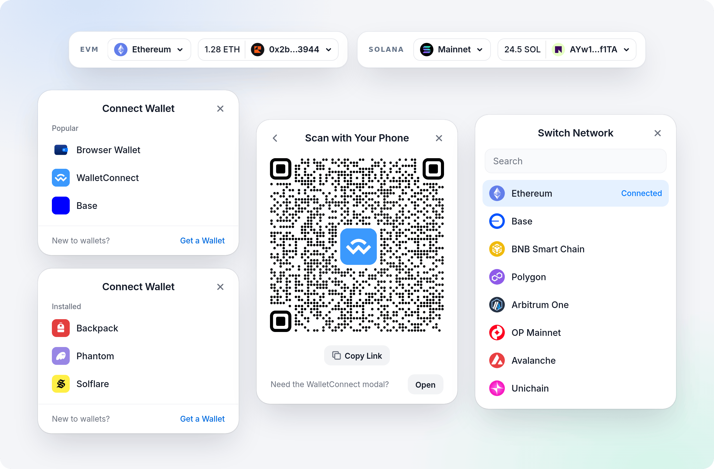

<div align="center">

# Solaris

**One React wallet kit for EVM chains and Solana.**

Connect, account, and network modals, wallet buttons, and themes that look and behave the same in both ecosystems.

[](https://www.npmjs.com/package/solariskit)
[](https://www.npmjs.com/package/solariskit)
[](https://github.com/akshatmittal/solaris/actions/workflows/ci.yml)
[](./packages/solariskit/src)
[](./LICENSE)

[**Live demo**](https://gh.akshatmittal.com/solaris/) · [Documentation](./packages/solariskit/README.md) · [npm](https://www.npmjs.com/package/solariskit) · [Changelog](./packages/solariskit/CHANGELOG.md)

<br />

<picture>
  <source media="(prefers-color-scheme: dark)" srcset="./.github/assets/hero-dark.png" />
  
</picture>

</div>

## Why Solaris

- **Two ecosystems, one UI.** EVM (Wagmi and Viem) and Solana (Solana Kit and Wallet Standard) share the same modals, buttons, themes, and avatars. Run both side by side in one app.
- **WalletConnect, done once.** One connector and one client drive both the Solaris QR code and the official WalletConnect modal, with telemetry, analytics, email, and social login turned off.
- **Pay only for what you use.** Every wallet SDK is an optional peer, Solana lives in its own `solariskit/solana` entry point, and the ESM output is unbundled so your bundler drops what you do not import.
- **Zero-runtime styles.** StyleX compiles to one static stylesheet. Every rule is scoped under the provider's `[data-solaris]` root, so nothing leaks into your app.
- **Themes with real control.** Light, dark, and midnight themes, plus accent color, radius, font stack, and overlay blur. Follow the system color scheme with one prop.
- **Accessible by default.** Focus trapping in modals, screen reader announcements for copy and connect status, and 4.5:1 text link contrast in the default themes.
- **Identity built in.** ENS names and avatars on EVM, and deterministic [polycon](./packages/polycons) avatars for every other address.
- **Next.js ready.** The `"use client"` directive ships in the build, and the EVM config is SSR-safe.
- **Strict TypeScript.** Typed configs, wallets, hooks, and themes, with declarations in the package.

## What you get

|                 | EVM                                                    | Solana                                                                  |
| --------------- | ------------------------------------------------------ | ----------------------------------------------------------------------- |
| **Import from** | `solariskit`                                           | `solariskit/solana`                                                     |
| **Provider**    | `SolarisEthereumProvider`                              | `SolarisSolanaProvider`                                                 |
| **Buttons**     | `ConnectButton`, `ChainSelectButton`, `WalletButton`   | `SolanaConnectButton`, `SolanaChainSelectButton`, `SolanaWalletButton`  |
| **Modal hooks** | `useConnectModal`, `useAccountModal`, `useChainModal`  | `useSolanaConnectModal`, `useSolanaAccountModal`, `useSolanaChainModal` |
| **Wallets**     | Injected (EIP-6963), WalletConnect, Base Account, Safe | Wallet Standard wallets and Mobile Wallet Adapter                       |
| **Built on**    | Wagmi 3, Viem 2, TanStack Query 5                      | `@solana/connector`, Solana Kit                                         |
| **Extras**      | Sign-In with Ethereum, recent transactions, ENS        | Balance, cluster, and Kit transaction signer hooks                      |
| **Custom UI**   | `ConnectButton.Custom`, `WalletButton.Custom`          | `SolanaWalletButton.Custom`                                             |

## Quick start

```bash
npm install solariskit wagmi@^3 viem@^2 @tanstack/react-query@^5
# Peers for the default EVM wallet list: WalletConnect and Base
npm install @walletconnect/ethereum-provider@^2.26.0 @reown/appkit@^1.8.19 @base-org/account@^2.5.1
```

```tsx
"use client";

import { useState, type PropsWithChildren } from "react";

import { QueryClient, QueryClientProvider } from "@tanstack/react-query";
import { ChainSelectButton, ConnectButton, getDefaultConfig, SolarisEthereumProvider } from "solariskit";
import { WagmiProvider } from "wagmi";
import { base, mainnet } from "wagmi/chains";
import "solariskit/styles.css";

const config = getDefaultConfig({
  appName: "My App",
  projectId: "YOUR_WALLETCONNECT_PROJECT_ID",
  chains: [mainnet, base],
  ssr: true,
});

export function Providers({ children }: PropsWithChildren) {
  const [queryClient] = useState(() => new QueryClient());

  return (
    <WagmiProvider config={config}>
      <QueryClientProvider client={queryClient}>
        <SolarisEthereumProvider>{children}</SolarisEthereumProvider>
      </QueryClientProvider>
    </WagmiProvider>
  );
}

export function Header() {
  return (
    <>
      <ChainSelectButton />
      <ConnectButton />
    </>
  );
}
```

Solana is one provider away:

```bash
npm install @solana/connector@^0.3.0 @solana/kit@^8.6.0
```

```tsx
import { getDefaultSolanaConfig, SolanaConnectButton, SolarisSolanaProvider } from "solariskit/solana";
import "solariskit/solana/styles.css";

const config = getDefaultSolanaConfig({ appName: "My App", network: "mainnet" });

<SolarisSolanaProvider config={config}>
  <SolanaConnectButton />
</SolarisSolanaProvider>;
```

To skip a wallet and its peers, pass your own wallet list. The [documentation](./packages/solariskit/README.md) covers every install option, theming, custom wallet lists, Sign-In with Ethereum, server rendering, and [migrating from RainbowKit](./packages/solariskit/README.md#migrating-from-rainbowkit).

## Repository

| Path                        | Package                                                                          | Description                                       |
| --------------------------- | -------------------------------------------------------------------------------- | ------------------------------------------------- |
| `packages/solariskit`       | [`solariskit`](https://www.npmjs.com/package/solariskit)                         | Wallet connection UI and hooks for EVM and Solana |
| `packages/polycons`         | [`@akshatmittal/polycons`](https://www.npmjs.com/package/@akshatmittal/polycons) | Deterministic avatar images for addresses         |
| `apps/example`              | [Live demo](https://gh.akshatmittal.com/solaris/)                                | Next.js app with EVM and Solana side by side      |
| `tooling/typescript-config` | —                                                                                | Shared strict TypeScript config                   |

## Development

Solaris uses Node 26, pnpm 12, Turborepo, tsdown, oxlint, oxfmt, and Changesets.

```bash
pnpm install
pnpm dev          # watch the library and run the example app
pnpm build
pnpm format:check
pnpm lint
pnpm typecheck
```

Set `NEXT_PUBLIC_WALLETCONNECT_PROJECT_ID` in `apps/example/.env.local` to try WalletConnect locally. Add a changeset with `pnpm changeset` for every change to a published package. Read the [contributing guide](./.github/CONTRIBUTING.md) before you open a pull request.

## License

[MIT](./LICENSE). Solaris started as a fork of [RainbowKit](https://github.com/rainbow-me/rainbowkit) by Rainbow.
